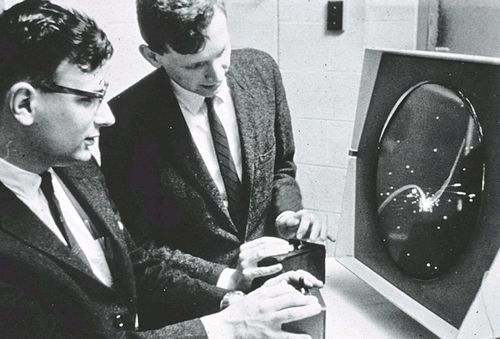

# Play/Past：逐文件讲解 + 老师课程考点地图

> 项目：`C:\Users\31826\Desktop\play-past`  
> 线上：https://ebenluo.github.io/work/  
> 仓库：https://github.com/EbenLuo/work

这份文档回答三件事：

1. 每个文件、每一大段代码是干什么的；
2. 它对应老师教学网站上的哪一页；
3. 哪些是笔试高频语法点，哪些其实**不考**，不要浪费时间。

标记：

- **★ 笔试高频**：阅读代码、找错、判断层级时最常出现。
- **◆ 答辩需要**：老师可能追问“为什么”。
- **○ 工程/维护**：项目需要，但不一定是笔试重点。

---

## 0. 先看老师的考试规则（决定复习优先级）

来源：

- [The Written Exam](https://webtech.landrock.io/exam/written-exam)
- [HTML, CSS or JavaScript?](https://webtech.landrock.io/exam/three-languages)
- [Reading HTML and CSS](https://webtech.landrock.io/exam/reading-code)
- [Spot the Error](https://webtech.landrock.io/exam/spot-the-error)
- [Practice Paper](https://webtech.landrock.io/exam/practice)

### 考试形式

- 2026 年 11 月 20 日，14:00–15:30，90 分钟，占 25%。
- **不写代码**，只读代码：说它做什么、判断 HTML/CSS/JS、找错误、写短句解释。
- 可以带笔和空白纸；不能带电子设备、笔记、书。

### 明确会考

| 范围 | 你要会做 |
|---|---|
| Web 基础 | 客户端/服务器、URL 各部分、DNS、请求/响应、状态码、Tim Berners-Lee 的四项发明 |
| 三种语言 | HTML 结构、CSS 表现、JS 行为；看一行代码判断是哪一种；出错时先开哪个文件 |
| 阅读 HTML | skeleton 四行、`head` vs `header`、标题层级、`strong/em`、`ul/ol/dl`、链接与路径、`img` 与 `alt`、table、label、语义元素 |
| 阅读 CSS | 规则组成、选择器、class/id、三种引入方式、`color` vs `background-color`、margin/border/padding、`display:flex` |
| 找错 | 未闭合标签/引号、错误嵌套、缺 `alt`、坏路径、缺分号/大括号、拼错属性、选择器不匹配 |
| 文件与格式 | 文件命名、相对/绝对路径、图片格式 |
| 身份素材 | favicon、app icon、OG 图各自的用途与尺寸 |
| 规划 | 页面四部分、先画草图、四个问题 |
| Git | Git/GitHub、repository/commit、add→commit→push、什么不能提交 |

### 明确**不考**

- 从记忆写完整页面/样式/脚本。
- 逐行解释 JavaScript。
- **specificity（优先级）和 inheritance（继承）**——老师明确写了不考。
- Vue / 框架。

> 结论：最后一周不要把时间花在背 `0,1,1,0` 这种 specificity 数字上。把时间花在 **HTML/CSS 找错、路径、标签配对、label/alt、flex/盒模型**。JavaScript 只要能认出“这是 JS、问题在行为层”，以及答辩时能解释 Playback。

---

## 1. 文件地图

| 文件 | 作用 | 考试相关 | 答辩相关 |
|---|---|---|---|
| `index.html` | 首页、论点、Playback 交互 | ★ HTML 结构、label、button、图片/链接 | ◆ 为什么这个交互、为什么四页 |
| `arcade.html` | 第一时代展品页 | ★ 图片、alt、路径、标题层级 | ◆ 为什么从街机开始 |
| `3d.html` | 第二时代展品页 | ★ 同上 | ◆ 为什么用真实照片、为什么 DualShock 是 1997 原版 |
| `online.html` | 第三时代展品页 | ★ 同上 | ◆ 为什么网络/触屏是第三次变化 |
| `assets/css/style.css` | 全站样式 | ★ 选择器、盒模型、flex/grid、单位、错误 | ◆ 视觉系统、响应式、图片展板 |
| `assets/js/main.js` | Playback 行为 | ★ 只需认出 JS/行为层；不考逐行 | ◆ 必须能解释 `events`、`nearestEvent`、`render` |
| `project.html` | 课程计划页，不是正式四页之一 | ○ | ◆ 五个想法、受众、四页、海报 |
| `design/og-poster.html` | OG 封面制作源文件 | ○ | ◆ 1200×630、标题+一句话+一个视觉 |
| `design/app-icon.html` | 图标制作源文件 | ○ | ◆ 32/180/512 方形 |
| `assets/icons/*.png` | favicon/app icon | ★ 用途与尺寸 | ◆ 为什么需要单独 180 文件 |
| `assets/images/**` | 12 张历史照片 + OG | ★ 路径、alt、格式 | ◆ 来源与版权判断 |
| `README.md` | 项目说明、live/repo | ○ | ◆ |
| `CREDITS.md` | 图片来源 | ○ | ◆ 图片不是自己编的 |
| `SUBMISSION.md` | 课程平台提交文案 | ○ | ◆ |
| `DEFENCE.md` | 答辩提纲 | ○ | ◆ 必读 |
| `.gitignore` | 不提交垃圾/截图 | ★ Git 什么不能提交 | ○ |

---

## 2. 每个 HTML 页面共用的 `<head>`（★ 高频）

以 `index.html` 1–23 行为例：

```html
<!DOCTYPE html>
<html lang="en">
<head>
  <meta charset="UTF-8">
  <meta name="viewport" content="width=device-width, initial-scale=1.0">
  ...
</head>
```

| 行 | 语句 | 作用 | 考点 |
|---|---|---|---|
| 1 | `<!DOCTYPE html>` | 告诉浏览器这是现代 HTML | ★ 去掉会进入 quirks mode（1990 年代行为） |
| 2 | `<html lang="en">` | 页面语言 | ★ 屏幕阅读器发音、搜索引擎；中文站应 `zh-CN`，本站英文 |
| 4 | `charset="UTF-8"` | 字符编码 | ★ 去掉中文/emoji 可能变乱码 |
| 5 | `viewport` | 手机按设备宽度渲染 | ★ 去掉手机显示桌面宽度再缩小 |
| 6 | `description` | 搜索/分享描述 | ○ |
| 7 | `theme-color` | 手机浏览器地址栏颜色 | ○ |
| 8 | `canonical` | 告诉搜索引擎规范地址 | ○ |
| 9 | `rel="icon"` | 浏览器标签图标 32×32 | ★ 身份素材 |
| 10 | `apple-touch-icon` | 手机主屏幕图标 180×180 | ★ 必须是另一张，不是 32 放大 |
| 11–20 | `og:*` / `twitter:card` | 分享卡片 | ★ OG 图 1200×630；`og:image` 必须是完整 `https://` |
| 21 | `<link rel="stylesheet">` | 外部 CSS | ★ 外链样式；路径错会全页无样式 |
| 22 | `<title>` | 标签页标题 | ★ 每页不同；缺了标签显示文件名 |

### `head` vs `header`（★ 高频）

- `<head>`：**关于页面**的信息，不可见；title、charset、CSS、favicon。
- `<header>`：**页面顶部**，可见；logo、站点名、导航。
- 两者只差四个字母，完全不同的东西。
- `<footer>` 是可见页脚；没有 `<foot>`。

### `defer`（○/◆）

`index.html` 第 160 行：

```html
<script src="assets/js/main.js" defer></script>
```

- `defer`：等 HTML 解析完再执行脚本，所以脚本能找到 `#year` 等元素。
- 没有 `defer` 且脚本在 head，可能拿到 `null`。
- 放在 `</body>` 前也可以；本项目放在末尾 + `defer`，双保险。

---

## 3. `index.html` 逐块讲解

### 3.1 跳转链接与页头：24–38 行

```html
<a class="skip-link" href="#main">Skip to content</a>
```

- 键盘用户按 Tab 第一个遇到的链接，跳到主内容。
- `#main` 对应 `<main id="main">`，同页片段链接。
- 这是可访问性，不是笔试核心，但答辩可能问。

```html
<header class="site-header">
  <a class="brand" href="index.html">Play/Past</a>
  <nav aria-label="Primary">
    <ul>...</ul>
  </nav>
</header>
```

| 语句 | 作用 | 考点 |
|---|---|---|
| `<header>` | 页面顶部 | ★ 语义元素；不是 `<head>` |
| `<a class="brand">` | 回首页 | ★ 链接路径 |
| `<nav aria-label="Primary">` | 导航地标 | ★ 导航链接应该用 `<nav>`；`aria-label` 区分多个 nav |
| `<ul>` / `<li>` | 链接是列表 | ★ 导航是链接列表，不是一堆 `<div>` |
| `aria-current="page"` | 标记当前页 | ◆ 可访问性；CSS 用它画下划线 |

### 3.2 Hero：40–50 行

```html
<section class="hero" aria-labelledby="hero-title">
  <p class="eyebrow">A brief history of input</p>
  <h1 id="hero-title">How <span>we played.</span></h1>
  <p class="lede">...</p>
  <a class="button" href="#eras">Explore the eras</a>
</section>
```

- `<section aria-labelledby="hero-title">`：这个 section 的可访问名称来自 h1。
- **一个页面一个 `<h1>`**；`<span>` 只用于把 “we played.” 变绿，不改变语义。
- `.lede` 是论点：游戏史不只是画面进步，而是交互方式变化。
- `href="#eras"`：跳到本页 `id="eras"` 的 section，不是另一个文件。
- **★** 标题不是用字号选的；h1 是页面主标题，视觉大小交给 CSS。

### 3.3 Playback：52–117 行（签名交互）

这是首页最重要的部分，也是答辩最可能问的。

```html
<section class="playback" id="playback" aria-labelledby="playback-title">
  <p class="eyebrow">Playback</p>
  <h2 id="playback-title">Choose a year. See what changed.</h2>
```

- `id="playback"`：可被链接/脚本定位。
- `aria-labelledby`：section 的名字来自 h2。

控件：

```html
<label for="year">Year</label>
<output id="year-output" for="year">1972</output>
<input type="range" id="year" name="year"
       min="1962" max="2025" step="1" value="1972"
       aria-describedby="year-help">
```

| 语句 | 作用 | 考点 |
|---|---|---|
| `<label for="year">` | 真的标签，不是 placeholder | ★ `for` 必须等于 input 的 `id` |
| `<output for="year">` | 显示当前年份 | ○ |
| `type="range"` | 滑块 | ★ 表单 input type |
| `min/max/step/value` | 范围和初始值 | ★ 数字范围；答辩要能解释 |
| `aria-describedby="year-help"` | 关联帮助文字 | ◆ |
| `name="year"` | 表单字段名 | ○（本页不在 form 里，但语义清楚） |

按钮：

```html
<button class="button" type="button" id="random-year">Surprise me</button>
```

- **★** `type="button"`：如果放在 `<form>` 里，默认是 submit，会提交页面；这里明确 button。
- `<button>` 用于动作；`<a>` 用于导航。不要用 `<div>` 当按钮。

结果区：

```html
<article class="playback-result" aria-labelledby="result-title">
  <p class="result-meta"><span id="result-year">1972</span> · <span id="result-era">the Arcade Era</span></p>
  <h3 id="result-title">Pong</h3>
  <p class="result-text" id="result-text">...</p>
  <a class="result-link" id="result-link" href="arcade.html">Read the Arcade Era</a>
</article>
```

- `<article>`：这块内容独立成立（一个展品）。
- h3：section h2 下的第三级标题。
- `id` 是 JS 更新的抓手；JS 不重建 HTML，只改文字/链接。
- 默认内容 1972/Pong：没有 JS 时仍有内容，不会空白。

隐藏状态区：

```html
<p class="visually-hidden" id="playback-status" role="status" aria-live="polite"></p>
```

- `role="status"` + `aria-live="polite"`：屏幕阅读器会读更新。
- `.visually-hidden` 是视觉隐藏，不是 `display:none`（后者屏幕阅读器也不读）。
- **★** `aria-live` 不是笔试重点，但答辩要能解释。

`<noscript>`：

```html
<noscript><p class="noscript">Playback needs JavaScript...</p></noscript>
```

- JS 被禁用时的降级说明；默认 Pong 仍然显示。
- 渐进增强：HTML 先能用，CSS 好看，JS 增强。

### 3.4 Thesis：119–126 行

- h2 + 一段解释，明确论点：三次变化改变的是“谁在玩、在哪玩、玩起来什么感觉”。
- 这是内容层，不是装饰；答辩要能复述。

### 3.5 Three eras：128–153 行

```html
<section class="eras" id="eras" aria-labelledby="eras-title">
  <h2 id="eras-title">Three eras. One question.</h2>
  <div class="era-grid">
    <article class="era-card">...</article>
  </div>
</section>
```

每张卡片：

```html
<p class="era-years">1962—1985</p>
<h3><a href="arcade.html">The Arcade Era</a></h3>
<p>Games left the arcade and moved into the living room.</p>
<p class="era-exhibits">Spacewar! · Pong · Atari 2600 · Famicom/NES</p>
```

- `<article>`：每张卡独立。
- h3：比 section h2 低一级。
- 年份用 `<p>` 而不是标题；它是数据/标签。
- 链接包在 h3 内：整句是链接，点击目标明确（不是 “click here”）。
- `.era-exhibits` 用中点分隔，不是列表；这是四个展品的摘要，不是必须按顺序的步骤。

### 3.6 页脚与脚本：156–160 行

- `<footer>`：站点页脚，不是 article 内的 footer。
- 版权/项目说明；`<script defer>` 加载 Playback。

---

## 4. 三个内页：`arcade.html` / `3d.html` / `online.html`

三个文件约 224 行，结构相同，只换内容/图片/当前导航。

### 4.1 共用结构

| 行段（arcade 为例） | 作用 | 考点 |
|---|---|---|
| 1–23 | head：title/description/OG/favicon/CSS | ★ 四行 skeleton、OG 图绝对地址 |
| 25 | skip link | ◆ |
| 27–37 | header + nav，当前页 `aria-current` | ★ nav/ul/aria-current |
| 40–52 | page-intro：eyebrow、h1、lede、page-meta | ★ 一个 h1；dl 用于键值对 |
| 54–195 | 四个 `<article class="exhibit">` | ★ semantic HTML、img/alt、figure/figcaption |
| 197–211 | sources/credits | ○ 来源 |
| 213–216 | pager（上一页/下一页） | ★ 链接路径 |
| 219–223 | footer | ○ |

### 4.2 `page-intro`

```html
<header class="page-intro">
  <p class="eyebrow">Chapter 01 · 1962—1985</p>
  <h1>The arcade went home.</h1>
  <p class="lede">...</p>
  <dl class="page-meta">
    <div><dt>Years</dt><dd>1962—1985</dd></div>
    <div><dt>Exhibits</dt><dd>04</dd></div>
    <div><dt>Focus</dt><dd>Public play → the living room</dd></div>
  </dl>
</header>
```

- `<header>` 是 main 里的页头，不是 `<head>`。
- `<dl>` 是 description list：`dt` 术语，`dd` 描述。**★** 这是三种列表之一，考试会问何时用。
- 这里 `dl` 装“Years / Exhibits / Focus”三对信息，语义合适。

### 4.3 每个展品：`<article>` 的固定套路

```html
<article class="exhibit">
  <figure class="exhibit-figure">
    <div class="figure-top"><span>Exhibit 01</span><span>1962</span></div>
    <div class="figure-frame">
      
    </div>
    <figcaption>Photo: ... <a href="...">Catalog record</a>.</figcaption>
  </figure>
  <div class="exhibit-copy">
    <p class="exhibit-year">1962</p>
    <h2>Spacewar!</h2>
    <p>...context...</p>
    <div class="exhibit-why">
      <h3>Why it mattered</h3>
      <p>...significance...</p>
    </div>
  </div>
</article>
```

| 语句 | 作用 | 考点 |
|---|---|---|
| `<article>` | 独立展品 | ★ 语义元素 |
| `<figure>` | 图片 + 说明是一个整体 | ○ |
| `<figcaption>` | 图片来源说明 | ○ |
| `` | 相对路径；必须小写/`/` | ★ 路径错误是最高频 |
| `width`/`height` | 预留比例，减少布局跳动 | ○ |
| `alt` | 描述图片内容 | ★ **每张图都要有**；装饰图才 `alt=""` |
| `h2` | 展品标题，页面 h1 下 | ★ 标题层级 |
| `h3` | Why it mattered 子标题 | ★ 不跳级 |
| 第一段 `<p>` | 历史背景 | ◆ 内容 |
| `.exhibit-why` 段 | 为什么重要，连接论点 | ◆ 答辩 |

**★ 常见错误：**

- `</img>` 是错的；`` 是空元素，没有闭合标签。
- `alt` 不能写 “image” 或文件名；要描述内容。
- 图片路径大小写：`Images/Hero.JPG` 在 Windows 可能能开，Linux 服务器 404。
- 路径用 `/`，不是 `\`；不能写 `C:\...`。
- 文件名不能有空格；用连字符。

### 4.4 三个内页的内容差异

| 页面 | 四个展品 | 论点 |
|---|---|---|
| `arcade.html` | Spacewar! / Pong / Atari 2600 / Famicom-NES | 公共街机 → 客厅 |
| `3d.html` | Doom / PlayStation / Nintendo 64 / DualShock | 镜头 + 摇杆成为控制器的一部分 |
| `online.html` | Xbox Live / World of Warcraft / iPhone / Switch | 网络 + 触屏把游戏带出客厅 |

每页都有：

- 一个 h1；
- 四个 h2 展品；
- 每个展品一个 `Why it mattered` h3；
- 页尾 Sources h2；
- pager 的上一页/下一页链接。

**答辩要能说：** 为什么是四个展品，不是十个；为什么这三个时代能支撑“input 改变游戏”的论点。

### 4.5 Sources 与 pager

```html
<section class="sources" aria-labelledby="sources-title">
  <h2 id="sources-title">Sources and credits</h2>
  <ul>...</ul>
</section>

<nav class="page-pager" aria-label="Chapter navigation">
  <a href="index.html"><span>Previous</span><strong>Home</strong></a>
  <a href="3d.html"><span>Next</span><strong>The 3D Revolution</strong></a>
</nav>
```

- 外部链接：`target="_blank" rel="noopener noreferrer"`。
- `rel="noopener"` 防止新页面通过 `window.opener` 操控原页面；`noreferrer` 不发送来源信息。
- pager 是 `<nav>`，因为它是导航链接；`aria-label` 区分主导航。
- **★** 所有 `href` 必须能解析；相对路径不要以 `/` 开头（GitHub Pages 子路径 `/work/` 会坏）。

---

## 5. `assets/css/style.css` 逐段讲解

CSS 834 行，按块看，不要一行一行背。考试重点是：**选择器、属性名、单位、分号/大括号、盒模型、flex、错误**。

### 5.1 设计变量：1–19 行

```css
:root {
  --bg: #0d0f0e;
  --ink: #f2ede3;
  --green: #a8e063;
  --shell: 76rem;
  --gutter: clamp(1.25rem, 4vw, 3rem);
}
```

- `:root` = 文档根元素（`html`），CSS 变量挂在这里。
- `var(--green)` 复用颜色；改一处全站变。
- `clamp(min, preferred, max)`：响应式尺寸；手机到桌面平滑变化。
- **★** `rem` 相对根字号；`em` 相对当前元素字号；`vw` 视口宽度；数字带单位（除 0 和部分无单位属性）。

### 5.2 全局盒模型与基础：21–81 行

```css
*, *::before, *::after { box-sizing: border-box; }
```

- **★ 高频**：默认 `content-box` 的 width 不含 padding/border；`border-box` 让 width 包含它们，布局更可预测。

```css
html { scroll-behavior: smooth; }
body {
  margin: 0;
  min-height: 100vh;
  background-color: var(--bg);
  background-image: linear-gradient(...), linear-gradient(...);
  color: var(--ink);
  font-family: var(--sans);
  font-size: clamp(1rem, 0.96rem + 0.2vw, 1.1rem);
  line-height: 1.7;
}
```

- `margin: 0` 去掉浏览器默认 body 外边距。
- `min-height: 100vh` 至少满屏。
- `background-image` 用两个 `linear-gradient` 画网格线；`background-size: 64px 64px`。
- `color` 是**文字**颜色，不是背景；背景是 `background-color`。**★ 高频**。
- `font-family` 字体栈：找不到第一个就用下一个。
- `line-height: 1.7` 无单位，随字号缩放。**★** 无单位是正确写法；`1.7px` 是错的。

```css
h1,h2,h3,p { margin: 0; }
h1,h2,h3 { font-family: var(--serif); font-weight: 400; }
a { color: var(--green); text-underline-offset: .2em; }
img { display:block; max-width:100%; }
```

- 选择器逗号 = “和”，同时选 h1/h2/h3/p。
- `img { max-width:100% }` 防止图片溢出容器；`display:block` 去掉行内底部空隙。
- `:focus-visible` 只对键盘焦点显示轮廓；不要删掉 outline。
- `::selection` 选中文字的颜色。

### 5.3 skip link 与 header：83–175 行

- `.skip-link` 固定在左上，默认 `translateY(-180%)` 移出屏幕；`:focus` 回到 0。**◆** 可访问性。
- `.site-header`：`position:sticky; top:0` 滚动时吸顶；`display:flex; justify-content:space-between` 左右分布；`width: min(calc(100% - gutter*2), 76rem); margin-inline:auto` 居中。
- `backdrop-filter: blur(12px)` 毛玻璃；`@supports not` 提供回退背景。
- `nav ul`：`display:flex; gap; list-style:none; padding:0`。
- `nav a[aria-current="page"]`：属性选择器，选当前页；`::after` 画下划线。
- **★** `display:flex` 让**子元素**在一行；`justify-content` 主轴对齐；`align-items` 交叉轴。
- **★** 选择器 `nav a` 选 nav 内所有 a；`nav a:hover` 只在悬停时。

### 5.4 首页 hero/thesis/eras：177–389 行

```css
main > section { width: min(...); margin-inline:auto; }
```

- `>` 只选直接子元素；`main > section` 不会选 section 里的 section。
- 所有主 section 统一宽度，居中。

```css
.hero { padding-block: clamp(4rem, 11vw, 8rem) ...; }
.hero h1 { font-size: clamp(3.4rem, 9.5vw, 7.6rem); line-height:.88; }
```

- `padding-block` = 上下 padding。
- 字号用 `clamp`：最小值/流体/最大值；不要在手机上用纯 `vw` 让字无限缩小。
- `.hero h1 span` 只把 span 变绿。

```css
.button { display:inline-flex; align-items:center; min-height:46px; border:1px solid ...; }
```

- 按钮/链接外观；`min-height` 保证触控目标。
- `text-decoration:none` 去掉下划线；`text-transform:uppercase` 视觉大写。
- `.button:hover` 背景/文字反转。

```css
.era-grid { display:grid; grid-template-columns:repeat(3,minmax(0,1fr)); gap:1.5rem; }
```

- **★ Grid**：三列等宽；`minmax(0,1fr)` 防止内容撑破。
- `.era-card { display:flex; flex-direction:column; }`：卡片内部纵向；`.era-exhibits { margin-top:auto }` 推到底部。

### 5.5 响应式：331–389、538–547、800–834 行

```css
@media (max-width: 900px) { .era-grid { grid-template-columns:1fr; } }
@media (max-width: 720px) { .site-header { align-items:flex-start; } .site-header nav { width:100%; } }
@media (max-width: 520px) { :root { --gutter:1.1rem; } ... }
```

- **★** `@media (max-width: …)`：满足条件才应用。
- 手机导航不靠 JS，靠 flex-wrap + width 100%；是渐进增强。
- 900px 三列→一列；720px 导航换行；520px 进一步缩小字号/间距。

### 5.6 Playback 样式：404–547 行

- `.playback`：上边框、上下间距、`scroll-margin-top` 防吸顶 header 遮住锚点。
- `.playback-panel`：Grid 两列 0.85fr/1.15fr。
- `.playback-controls`：右分割线、padding。
- `.year-head`：flex，label 左、output 右。
- `input[type="range"]`：`accent-color` 原生滑块颜色；`cursor:pointer`。
- `button.button`：button 默认有背景/边框，覆盖为透明；`font: inherit` 继承字体；`cursor:pointer`。
- `.playback-result`：flex 纵向居中。
- **★** 这里的选择器 `input[type="range"]` 是属性选择器；`button.button` 是元素+类。
- **★** `display:grid`/`flex` 的区别：Grid 定二维行列；Flex 一维排布。

### 5.7 内页样式：563–834 行

```css
.page-intro { width:min(...); margin-inline:auto; padding-block:...; border-bottom:...; }
.page-intro h1 { font-size:clamp(...); line-height:.92; }
```

- 内页 header 和首页 section 不共享 `main > section`，所以单独给宽度。

```css
.exhibit { display:grid; grid-template-columns: .9fr 1.1fr; gap; align-items:center; }
.exhibit:nth-child(even) .exhibit-figure { order:2; }
```

- **★** `:nth-child(even)` 选偶数个 `.exhibit`，让图片左右交替。
- `order` 只在 flex/grid 容器中生效。

```css
.exhibit-figure { padding:.9rem; border:1px solid; background:#f3eee4; }
.figure-frame { position:relative; display:grid; width:100%; aspect-ratio:4/3; overflow:hidden; }
.figure-frame--portrait { aspect-ratio:3/4; }
.exhibit-photo { position:absolute; inset:0; width:100%; height:100%; object-fit:contain; mix-blend-mode:multiply; }
```

- **★ 盒模型**：`padding` 是内边距；`border` 是边；`background` 是背景。
- `aspect-ratio` 固定宽高比。
- **★** 图片之前被裁切的原因：父容器有比例、子元素 `height:100%` 未解析；改为绝对定位 + `inset:0` + `object-fit:contain` 后完整显示。
- `object-fit: contain` 保证完整，不裁切；`cover` 会填满但裁切。
- `mix-blend-mode:multiply` 让白底照片融进纸色；答辩可解释为“档案展板”的视觉处理。
- `figcaption`：图片说明，小于正文；`border-top` 分隔。
- `figcaption a`：深绿色链接，保证在浅色纸上的对比度。

```css
.sources ul { display:grid; grid-template-columns:repeat(2,minmax(0,1fr)); gap; list-style:none; }
.page-pager { display:grid; grid-template-columns:repeat(2,minmax(0,1fr)); }
.page-pager a:last-child { align-items:flex-end; border-left:1px solid; text-align:right; }
```

- **★** `list-style:none` 去掉项目符号；`padding:0` 去掉默认缩进。
- `a:last-child` 选最后一个链接；`border-left` 分割线。
- 手机 `@media (max-width:800px)` 单列；`order:0` 把图片放回文字前；`page-pager` 单列。

### 5.8 reduced motion：549–561 行

```css
@media (prefers-reduced-motion: reduce) { ... transition-duration:.01ms !important; }
```

- 尊重系统“减少动态效果”；答辩可提。
- **★** `!important` 在考试里不是重点；老师明确不考 specificity，但仍要知道它会覆盖普通声明。

### 5.9 CSS 高频错误（来自老师 Spot the Error）

| 错误 | 结果 | 正确 |
|---|---|---|
| `colour: red;` | 忽略 | `color: red;` |
| `background-colour` | 忽略 | `background-color` |
| `font-size:16;` | 忽略 | `font-size:16px;` |
| `font-size:16 px;` | 忽略 | `16px` |
| 缺 `;` | 下一条也被吞 | 每条声明 `;` |
| 缺 `}` | 后面的规则坏 | 配对 |
| `color = red;` | 忽略 | `color: red;` |
| `.Quote` vs `class="quote"` | 匹配不到 | 大小写一致 |
| `#quote` vs class | 匹配不到 | class 用 `.`，id 用 `#` |
| `// comment` | 不是 CSS 注释 | `/* comment */` |
| `styles.css` vs `style.css` | 全页无样式 | 文件名一致 |

**★ 记住：** 最后一条声明的分号可省略，所以“缺分号”常常在下一行才暴露；`line-height:1.5`、`font-weight:800` 可以没有单位。

---

## 6. `assets/js/main.js` 逐块讲解

> 考试不逐行考 JS；但答辩一定会问 Playback。以下按块理解。

### 6.1 外层函数：1–3 行

```js
(function () {
  "use strict";
  ...
})();
```

- IIFE：立即执行函数，变量不污染全局。
- `"use strict"`：严格模式，减少静默错误。
- 结尾 `})();` 立即调用。

### 6.2 事件数组：4–96 行

```js
const events = [
  { year: 1962, title: "Spacewar!", era: "the Arcade Era", href: "arcade.html", text: "..." },
  ...
];
```

- `const`：变量不能再指向另一个数组，但数组内容可改。
- 每个元素是对象 `{ key: value }`，字段：year/title/era/href/text。
- 用数组是因为顺序/遍历/随机选择都方便。
- 数据全是英文；没有从服务器请求，符合 no backend。
- **★** 考试只可能问“这是 JS 吗”，不会让你解释 `reduce`。

### 6.3 DOM 查找与 guard：98–108 行

```js
const range = document.getElementById("year");
if (!range) return;
```

- `document.getElementById` 按 id 找元素。
- `if (!range) return;`：如果这个脚本被别的页面加载、没有 #year，就直接结束，不报错。**◆** 防御性编程。
- 后续 `getElementById` 拿 output/title/text/link/button/status。

### 6.4 当前年份：110 行

```js
let currentYear = 1972;
```

- `let` 可重新赋值；`const` 不可。
- 用于“随机不要重复当前年份”。

### 6.5 `nearestEvent`：112–118 行

```js
function nearestEvent(year) {
  return events.reduce(function (closest, event) {
    return Math.abs(event.year - year) < Math.abs(closest.year - year)
      ? event : closest;
  }, events[0]);
}
```

- `reduce` 遍历数组，累积最接近的事件。
- `Math.abs` 绝对差；三元 `? :` 选更近的。
- 为什么需要：滑块是 1962–2025 每年，但事件只有 13 个；要找最近展品。
- **◆ 答辩重点**：不是“年份必须精确等于事件”，而是“snap 到最近展品”。

### 6.6 `render`：120–136 行

```js
function render(event, announce) {
  currentYear = event.year;
  range.value = String(event.year);
  range.setAttribute("aria-valuetext", event.year + ", " + event.title);
  ...
  resultLink.href = event.href;
  resultLink.textContent = "Read " + event.era;
  if (announce && status) status.textContent = ...;
}
```

- `String()` 转字符串；`range.value` 是字符串。
- `setAttribute("aria-valuetext", ...)` 让屏幕阅读器读“1972, Pong”，不只是数字。
- `textContent` 改文字，不解析 HTML；比 `innerHTML` 安全（避免注入）。
- `href` 改链接目标；`textContent` 改链接文字。
- `announce` 控制是否写入 `aria-live` 状态；拖动时不必每条都播报，change 时播报。
- **★** `textContent` vs `innerHTML`：前者纯文本，后者解析标签、可能 XSS。考试可能只考“这行 JS 做什么”。

### 6.7 事件监听：138–144 行

```js
range.addEventListener("input", ...);
range.addEventListener("change", ...);
```

- `input`：拖动过程中持续触发；更新视觉，不播报。
- `change`：值确定/松开时触发；更新并播报。
- `addEventListener("事件", 函数)`；不要写 `onclick=`。
- **◆** 为什么两个事件：视觉即时 + 屏幕阅读器不刷屏。

### 6.8 随机按钮：146–156 行

```js
randomButton.addEventListener("click", function () {
  if (events.length < 2) return;
  let next = events[Math.floor(Math.random() * events.length)];
  while (next.year === currentYear) { next = ...; }
  render(next, true);
});
```

- `Math.random()` 0–1；乘长度、`Math.floor` 得索引。
- `while` 避免随机到当前同一个。
- `click` 事件；按钮是 `type="button"`，不会提交表单。

### 6.9 初始渲染：158 行

```js
render(nearestEvent(1972), false);
```

- 页面加载时显示 1972/Pong；不播报（初始内容已在 HTML 里）。
- 没有 JS 时，HTML 默认仍显示 Pong；这是渐进增强。

### 6.10 JS 高频认知

- 识别：`const/let/function/document.getElementById/addEventListener` → JavaScript。
- 找错：按钮没反应 → JS 层，开 Console；不是 CSS。
- 不考：逐行解释、闭包、`reduce` 细节；但答辩要能讲。

---

## 7. 其他文件

### `project.html`（50 行）

- 课程计划页，不是正式四页之一；`<meta name="robots" content="noindex">`。
- `h1` 项目计划；五个想法用 `<ol>`；每个想法给谁看用 `<dl><dt><dd>`；My Choice 记录标题/受众/四页/最小版本/图片计划。
- **★** `<ol>` 用于有顺序的列表；`<dl>` 用于成对信息。考试会问区别。
- 答辩：五个想法说明你不是只想到一个；受众具体。

### `README.md`

- 项目标题、live、repo、四页、Playback、技术、图片来源、本地运行。
- GitHub 仓库首页；老师先看到它。

### `CREDITS.md`

- 每张历史照片的 File、Source、Credit、License、Accessed。
- 老师允许网上找图，但“properly sourced”必须做到；不能编造 CC0。

### `SUBMISSION.md`

- 课程平台需要的标题、一句话、3–5 段描述、live、repo、图片清单。
- **✓ 已按 assignment 页要求生成精确尺寸**：桌面 **1920×1080**、手机 **375×812**；OG 1200×630；app icon 180；favicon 32。

### `DEFENCE.md`

- 3 分钟演示流程 + 10 个问答。
- 答辩 5 分钟、无 slides；3 分钟展示，2 分钟提问。

### `design/og-poster.html`

- 1200×630 OG 封面源文件；用 HTML/CSS 精确排版，再截图导出。
- `og:image` 必须绝对地址；尺寸 1200×630；<100 KB。
- 这是“封面设计”，不是历史照片；历史照片全部有来源。

### `design/app-icon.html` + `assets/icons/*.png`

- 512 主图 → 180 apple-touch-icon → 32 favicon。
- **★** 图标必须方形；32 和 180 是两个文件，不能把 32 放大当 180。
- `favicon` 浏览器标签；`apple-touch-icon` 手机主屏；`og:image` 分享卡片。

### `.gitignore`

```text
.DS_Store
Thumbs.db
desktop.ini
node_modules/
.env
*.log
screenshots/
```

- **★** `.env` 永远不提交；`node_modules` 不提交；系统垃圾不提交。
- `screenshots/` 是本地提交材料，不进仓库。

### 图片目录

- `assets/images/arcade/` 4 张；`3d/` 4 张；`online/` 4 张；`og-image.jpg`。
- 全部本地，不 hotlink；路径小写、连字符。
- 每张有 `alt`，每页有图下 credit 和 Sources。

---

## 8. 要求 → 文件 → 老师课程 → 考试

| 要求 | 在哪里实现 | 老师哪里讲过 | 考试关联 |
|---|---|---|---|
| 至少四页 + 导航 | 4 个 html；每页 `<nav>` | Lesson 2 链接；Lesson 4 结构；Recap | ★ 链接/路径/nav 语义 |
| 自己的内容 | 页面文案、论点 | Project brief | ◆ 答辩 |
| 语义 HTML | header/nav/main/section/article/figure/footer | Lesson 2.7；Reading HTML | ★ 高频 |
| 响应式 | CSS media queries | Lesson 3；Recap | ★ flex/grid/单位；手机 |
| 交互 | Playback | Lesson 4 第一个 JS；Project | ★ 识别 JS/层；答辩解释 |
| 真实地址 | GitHub Pages | Project/Assignment | ○ |
| Git 历史 | 11+ commits | Git & GitHub | ★ add/commit/push、Git vs GitHub |
| 身份素材 | icons/OG | Lesson 4 favicon；Project | ★ 尺寸/用途 |
| 无服务器/数据库 | static | Project | ◆ |
| 答辩 | DEFENCE.md | Project | ◆ 15% |

---

## 9. 笔试高频清单（最后一周背这些）

### HTML

1. `<!DOCTYPE html>` / `lang` / `charset` / `viewport` 各防什么问题。
2. `<head>` vs `<header>`；`<footer>`；没有 `<foot>`。
3. 一个 `<h1>`；标题不跳级；标题不是字号。
4. `<strong>/<em>` 有语义；`<b>/<i>` 只是外观。
5. `<ul>` 无序、`<ol>` 有序、`<dl><dt><dd>` 成对。
6. 相对路径 vs 绝对路径；`/` 不是 `\`；大小写；无空格。
7. `` 需要 `src` + `alt`；没有 `</img>`。
8. `<table>` 只用于数据；`caption`/`th` 的作用。
9. 每个 input 要 `<label for>`，`for` 匹配 `id`。
10. 语义元素：nav/main/article/section/aside/header/footer/div。
11. 标签闭合顺序；引号配对。
12. 一个 id 只能一次；class 可多次。

### CSS

1. 规则 = selector + `{ property: value; }`。
2. `color` 是文字；`background-color` 是盒子。
3. 盒模型：content → padding → border → margin。
4. `display:flex` 让子元素一行；`gap` 间距；`justify-content`/`align-items`。
5. Grid：`grid-template-columns`；`repeat`、`minmax`、`1fr`。
6. 单位：`px`、`rem`、`em`、`%`、`vw`；长度大多要单位。
7. 三条引入方式；外部 `<link rel="stylesheet">` 最佳。
8. 常见错误：`colour`、缺 `;`、缺 `}`、`16 px`、`.Quote`、`#quote`、`//` 注释、文件名不匹配。
9. `@media` 响应式。
10. specificity/inheritance **不考**，别背。

### 三语言 / 找错 / 其他

- HTML 是标签；CSS 是选择器+大括号；JS 是 `const/let/function/document` 等。
- 页面无样式 → 先看 `<link>`；一个规则失效 → CSS；按钮没反应 → JS；图片 404 → 路径/大小写。
- 404 = 请求方地址错；500 = 服务器错。
- URL：host/path/query/fragment；fragment 不发给服务器。
- Git：`add` 选择 → `commit` 记录 → `push` 上传；Git 本地，GitHub 在线。
- OG 1200×630；favicon 32×32；apple-touch 180×180；都方形，PNG。

---

## 10. 这份项目最容易被问的 8 个答辩问题

1. 为什么是游戏史，而不是完整年表？  
   → 完整年表太散；用“输入改变游戏”的论点收窄成三个时代，四页才讲得深。

2. 为什么四页，不是更多？  
   → 课程最低四页；每页四个展品，保证内容、图片、手机测试都能完成。

3. 为什么用博物馆照片？  
   → 老师允许网上图片；但必须 properly sourced。照片存本地、图下 credit、CREDITS.md，避免 hotlink 和 404。

4. 为什么 DualShock 用 1997 官方图？  
   → 之前找到的 PS2 DualShock 2 不属于 1997；换成 Sony 官方历史页的初代 DualShock，保证年代正确。

5. Playback 怎么工作？  
   → 数组存事件；`nearestEvent` 用 `reduce` + `Math.abs` 找最近；`render` 更新年份/标题/文本/链接/aria；input 更新视觉，change 播报。

6. 为什么没有服务器/数据库？  
   → 静态站点，GitHub Pages 足够；Playback 在浏览器内完成，不需要存储用户数据。

7. 最难修的 bug？  
   → 图片在 `aspect-ratio` 容器里被裁切；原因是百分比高度/定位。改成绝对定位 + `object-fit:contain`。另一个是 `index.html` 里重复的 meta/link 和多余 `</span>`。

8. 如果多一周做什么？  
   → 更多年份事件、按时代筛选、更多真实手机测试、把来源换成更强的博物馆 primary source。

---

## 11. 现在最该做的三件事

1. **把这份文档对着代码读一遍**，尤其是 `index.html` 52–117 和 `main.js` 112–158。
2. **做一次 90 分钟 Practice Paper**（不要开答案），然后按错题回到对应 lesson。
3. **改提交截图尺寸**：课程 assignment 页要求桌面 1920×1080、手机 375×812。现在已生成：
   - `screenshots/submission-desktop-1920x1080.png`
   - `screenshots/submission-mobile-375x812.png`

> 老师原话：**Work you cannot explain does not pass — however it was made.**  
> 网站已经能跑；最后决定分数的是你能不能解释每个选择。
